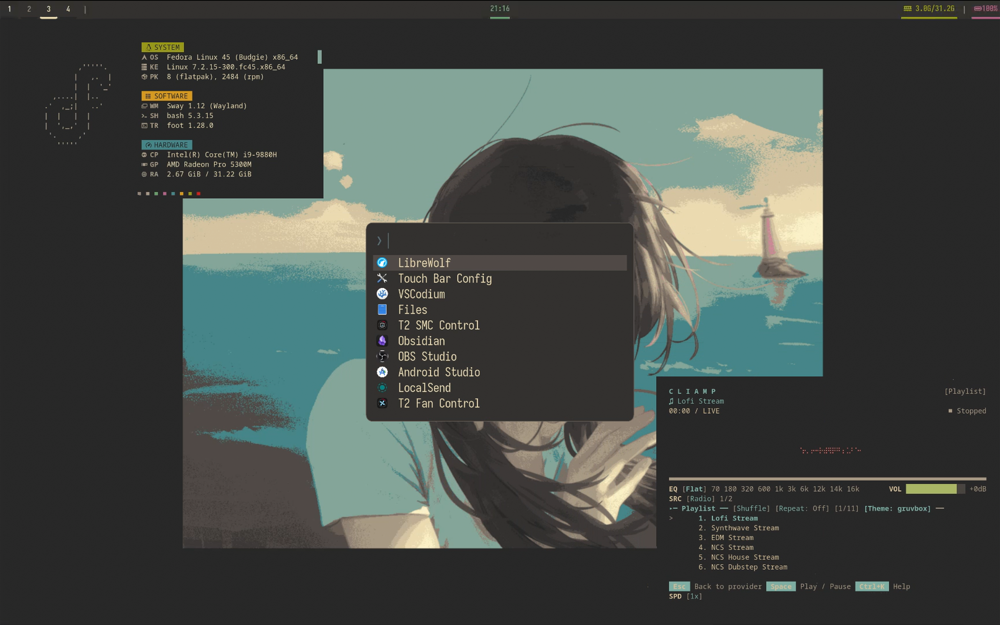
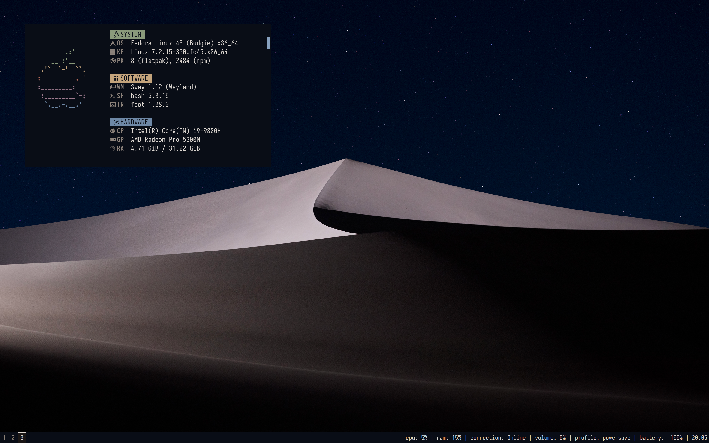

# Dotfiles

My personal, keyboard centric Sway setup. Everything is kept as simple as possible.

| Gruvbox | Kyanite |
| :---: | :---: |
|  |  |

## Themes Included

Repo contains two themes:
* **`Kyanite`**: Ultra-minimal Desert Night theme built on top of stock `sway` & `swaybar` with a zero-fork bash script and `wmenu`.
* **`Gruvbox`**: Classic warm Gruvbox Dark theme using `waybar` and `fuzzel`.

## Packages

* **OS:** KAIT2EN (Fedora) / Arch
* **Window Manager:** Sway
* **Terminal:** Foot
* **Status Bar:** Swaybar (`Kyanite`) / Waybar (`gruvbox`)
* **Launcher:** Wmenu (`Kyanite`) / Fuzzel (`gruvbox`)
* **Browser:** LibreWolf + Sidebery
* **Code:** VSCodium / Vis
* **System Info:** Fastfetch
* **Font:** Iosevka Nerd Font (`Iosevka NF`)

## Folder Structure

```text
dotfiles/
├── gruvbox
│   ├── colors.toml
│   ├── fastfetch
│   │   └── config.jsonc
│   ├── foot
│   │   └── foot.ini
│   ├── fuzzel
│   │   └── fuzzel.ini
│   ├── librewolf
│   │   ├── userChrome.css
│   │   └── userContent.css
│   ├── sway
│   │   └── config
│   ├── vsc
│   │   └── settings.json
│   ├── walls
│   │   ├── 1.png
│   │   └── 2.png
│   └── waybar
│       ├── config.jsonc
│       └── style.css
├── kyanite
│   ├── colors.toml
│   ├── fastfetch
│   │   └── config.jsonc
│   ├── foot
│   │   └── foot.ini
│   ├── librewolf
│   │   ├── userChrome.css
│   │   └── userContent.css
│   ├── sway
│   │   ├── config
│   │   └── status.sh
│   ├── vsc
│   │   └── settings.json
│   └── walls
│       ├── 1.jpg
│       └── 2.jpg
├── Assets
│   ├── Gruvbox.png
│   └── Kyanite.png
├── install.sh
└── README.md
```

## How to Use

First, clone the repo into your Documents or home folder:

```bash
git clone https://github.com/bolobtw/dotfiles.git ~/Documents/
cd ~/Documents/dotfiles
```

### Quick Install / Theme Switcher (Recommended)
Run `install.sh` to install or switch between `kyanite` and `gruvbox`. It will ask which theme you want, optionally apply the VSCodium and LibreWolf + Sidebery themes, and swap/reload your Sway bar automatically:

```bash
chmod +x install.sh
./install.sh
```

* **Saved Browser Path:** The first time you apply the LibreWolf theme, `install.sh` will ask for your profile folder path and save it to `~/.config/dotfiles_lw_profile`. On future theme switches, you can just press `Enter` to reuse it.
* **LibreWolf + Sidebery Note:** Set your browser theme to **Default** or **Dark** in `about:addons`, and keep Sidebery's internal **Styles editor** empty so `userContent.css` can style it automatically.

---

### Manual Installation

#### 1. Applying a Theme (Sway, Foot, Fastfetch)
Pick which theme folder you want (`kyanite` or `gruvbox`) and copy the configs over to `~/.config`:

```bash
# Example using Kyanite (swap 'kyanite' with 'gruvbox' if you'd rather use gruvbox)

mkdir -p ~/.config/sway ~/.config/foot ~/.config/fastfetch

cp -r kyanite/sway/* ~/.config/sway/
cp kyanite/foot/foot.ini ~/.config/foot/
cp kyanite/fastfetch/config.jsonc ~/.config/fastfetch/

# If using Kyanite, make sure the status script is executable:
chmod +x ~/.config/sway/status.sh

# If using gruvbox, also copy the waybar and fuzzel configs:
mkdir -p ~/.config/waybar && cp -r gruvbox/waybar/* ~/.config/waybar/
mkdir -p ~/.config/fuzzel && cp -r gruvbox/fuzzel/fuzzel.ini ~/.config/fuzzel/
```

Reload Sway with `Super+Shift+C` to apply the changes.

#### 2. Applying the VSCodium Theme
Copy the `settings.json` file to your VSCodium user config directory:

```bash
mkdir -p ~/.config/VSCodium/User
cp kyanite/vsc/settings.json ~/.config/VSCodium/User/settings.json
```

#### 3. Applying the LibreWolf & Sidebery Theme
These themes use `userChrome.css` for the browser toolbar and `userContent.css` for Sidebery:

1. Open LibreWolf, type `about:config` in the URL bar, and set `toolkit.legacyUserProfileCustomizations.stylesheets` to **`true`**.
2. Set your browser's built-in theme to **Default** or **Dark** in `about:addons`, and leave Sidebery's **Styles editor** empty.
3. Find your active profile folder in `about:support` (next to **Profile Directory**), create a `chrome` folder inside it, and copy both CSS files into it:

```bash
# Profile paths are very specific 
mkdir -p ~/.librewolf/<replace-me>/chrome
cp kyanite/librewolf/*.css ~/.librewolf/<your-profile>/chrome/
```

Restart the browser and the theme will load automatically.